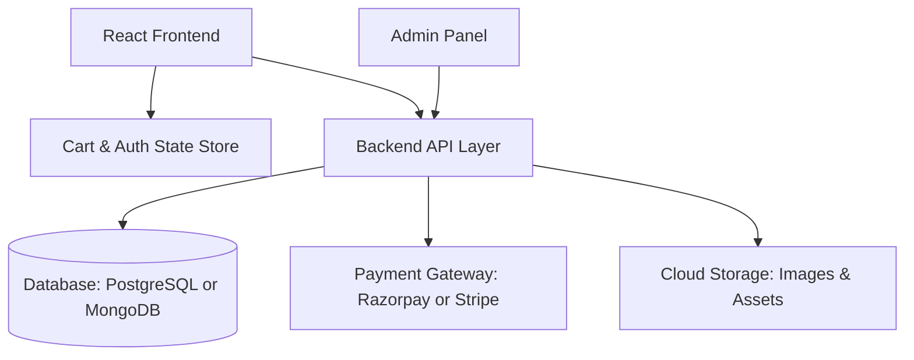

# SoleThief E-Commerce Architecture & Gap Analysis Report

## 1. Executive Summary
SoleThief currently functions as an interactive concept/showcase landing page with creative aesthetics (Japanese Noren curtain animation, Matter.js 2D physics hanging sneakers, and streetwear typography). However, it lacks all the foundational layers required of a production-ready e-commerce platform.

## 2. Current Architecture vs Complete E-Commerce Matrix

| Feature / Domain | Current State in SoleThief | Production Requirement |
|---|---|---|
| **Catalog & Inventory** | 4 hardcoded shoes in [`src/data/shoes.js`](src/data/shoes.js:1) | Database-backed catalog with real-time stock levels and variants |
| **Shop Page** | Placeholder saying "Coming Soon" in [`src/pages/Shop.jsx`](src/pages/Shop.jsx:1) | Search, filter (brand, size, price), sort, pagination |
| **Product Detail** | Read-only details with disabled purchases in [`src/components/ProductDetails.jsx`](src/components/ProductDetails.jsx:49) | Size selection, Add to Cart, Buy Now, stock indicator, reviews |
| **Cart System** | Placeholder saying "Coming Soon" in [`src/pages/Cart.jsx`](src/pages/Cart.jsx:1) | Persistent cart (Context/Zustand), quantity modification, subtotal calculation |
| **Checkout Flow** | Missing | Multi-step shipping address, order review, payment gateway integration |
| **Payment Gateway** | Missing | Razorpay / Stripe / Cash-On-Delivery with webhooks |
| **Authentication & Users** | Missing | User accounts, guest checkout, order history, wishlist |
| **Backend & Database** | Pure client-side static bundle | Node/Express, Next.js API, Supabase, or headless commerce backend |
| **Admin & Operations** | Missing | Order management, product uploads, inventory reconciliation |

## 3. High-Level Target System Architecture

## 4. Phased Implementation Roadmap

### Phase 1: Core Client-Side Shopping Experience
- Implement Global Cart State with persistence via localStorage.
- Build the Cart drawer and full [`src/pages/Cart.jsx`](src/pages/Cart.jsx:5) page.
- Enable Add to Cart and Size Selection on [`src/components/ProductDetails.jsx`](src/components/ProductDetails.jsx:1).
- Implement the Catalog in [`src/pages/Shop.jsx`](src/pages/Shop.jsx:5) with filtering, search, and sorting.

### Phase 2: Checkout & Payment Integration
- Build a Checkout page with shipping address inputs and validation.
- Implement payment integration with Stripe or Razorpay.
- Create an Order Confirmation screen with order summaries.

### Phase 3: Backend & Database Persistence
- Deploy a backend API (Node.js/Express or Supabase).
- Implement product catalog endpoints, stock tracking, and order creation.
- Handle payment verification webhooks.

### Phase 4: Customer Accounts & Retention
- Add user authentication (email/password, OAuth).
- Build customer profiles with order history and saved addresses.
- Add sneaker wishlist / favorites feature.

### Phase 5: Operations & Admin Management
- Build an Admin dashboard for managing sneaker inventory, drops, and orders.
